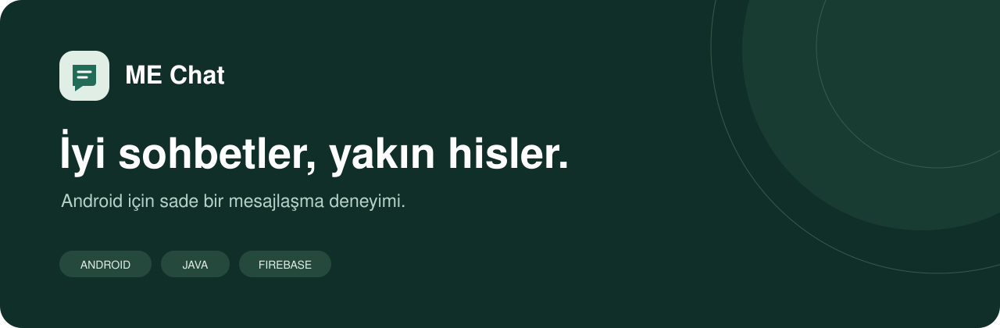
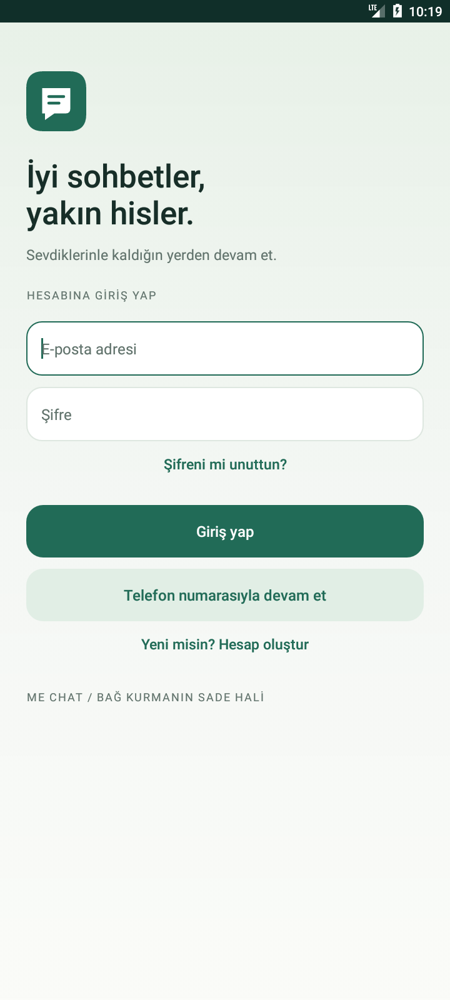
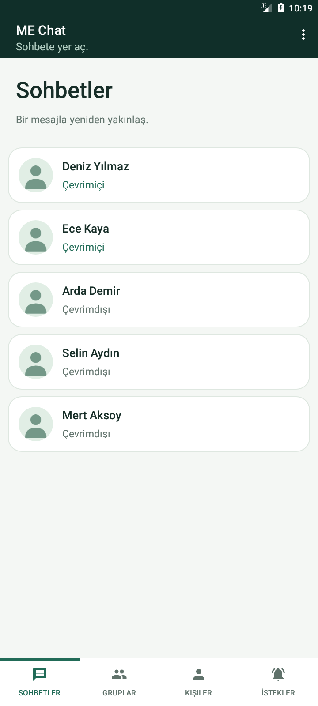
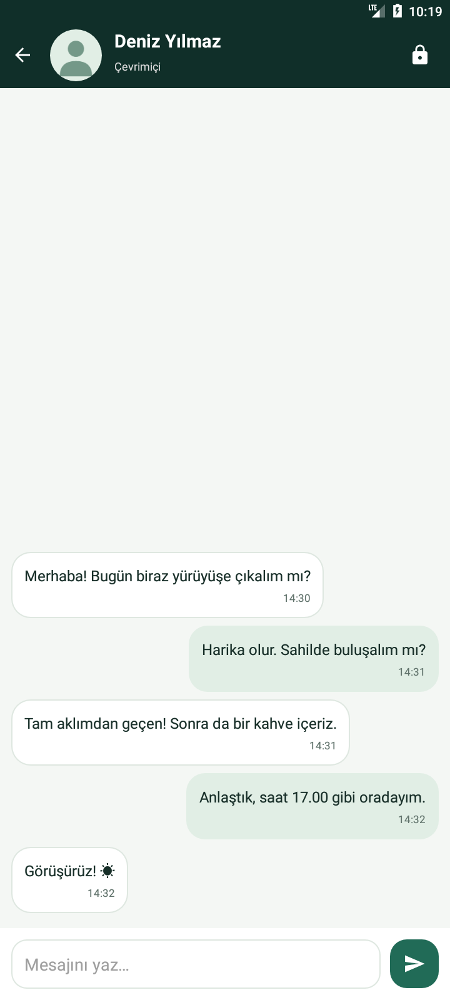

<p align="center">
  
</p>

<p align="center">
  <strong>İnsanları yakınlaştıran, sade bir Android mesajlaşma deneyimi.</strong><br />
  Birebir sohbetler, herkese açık gruplar ve sana ait bir profil.
</p>

<p align="center">
  <a href="#ekran-görüntüleri">Ekranlar</a> ·
  <a href="#özellikler">Özellikler</a> ·
  <a href="#kurulum">Kurulum</a> ·
  <a href="docs/tanitim/README.md">Tanıtım ve galeri</a>
</p>

---

## ME Chat

ME Chat; Java ve Firebase ile geliştirilen, Android için yerel bir mesajlaşma uygulamasıdır. Açık zeminler, koyu yeşil vurgular, okunaklı mesaj balonları ve sade gezinme yapısı sayesinde odağı sohbetin kendisinde tutar.

| Platform | Dil | Arayüz | Altyapı |
| --- | --- | --- | --- |
| Android 6.0+ · API 23+ | Java 17 | XML · Material Components | Firebase Auth · Realtime Database · Storage |

## Ekran görüntüleri

<table>
  <tr>
    <td align="center" width="33%"><strong>Karşılama</strong><br /><br /></td>
    <td align="center" width="33%"><strong>Sohbetler</strong><br /><br /></td>
    <td align="center" width="33%"><strong>Mesajlaşma</strong><br /><br /></td>
  </tr>
</table>

Görseller uygulamanın gerçek Android yerleşimlerinden alınmıştır. İsimler, profil bilgileri, çevrimiçi durumları ve mesajlar tanıtım amacıyla kullanılan kurgusal verilerdir; canlı kullanıcı verisi değildir.

**[Altı ekranın tamamını incele →](docs/tanitim/README.md#ekran-galerisi)**

## Özellikler

- **Birebir mesajlaşma:** Gerçek zamanlı metin mesajları ve son mesaja göre sıralanan sohbetler.
- **Özel mesajlarda uçtan uca şifreleme:** Google Tink tabanlı şifreleme, güvenlik numarası karşılaştırması ve anahtar değişimi uyarıları.
- **Herkese açık gruplar:** Grup oluşturma, grupları listeleme ve grup içinde mesajlaşma.
- **Kişiler ve istekler:** Kullanıcı adına göre arama, sohbet isteği gönderme, kabul etme ve reddetme.
- **Hesap seçenekleri:** E-posta/şifre ile kayıt ve giriş, şifre sıfırlama ve SMS ile telefon doğrulaması.
- **Kişisel profil:** Fotoğraf seçme ve kırpma, ad, soyad, kullanıcı adı ve hakkında bilgisi.
- **Çevrimiçi durum:** Çevrimiçi/çevrimdışı bilgisi ve son görülme zamanı.
- **Tutarlı arayüz:** Etiketli alt sekmeler, yumuşak ekran geçişleri, kaydırılabilir formlar ve boş liste durumları.

## Tasarım yaklaşımı

Arayüz, sıcak bir açık zemin ile koyu yeşil başlık alanlarını birleştirir. Ortak tipografi, kontrollü boşluklar ve yuvarlatılmış bileşenler tüm ekranlarda aynı görsel dili korur. Mesaj yazma alanları, form doğrulamaları ve dokunma geri bildirimleri günlük kullanımı kolaylaştıracak şekilde düzenlenmiştir.

Renk paleti ve ekran akışları için [tasarım tanıtımına](docs/tanitim/README.md#tasarım-dili) bakabilirsin.

## Teknik yapı

| Katman | Kullanılan yapı |
| --- | --- |
| Ekranlar | Activity · Fragment · View Binding |
| Listeler ve gezinme | RecyclerView · ViewPager2 · TabLayout |
| Kimlik doğrulama | Firebase Authentication |
| Mesajlar ve kullanıcı verileri | Firebase Realtime Database · FirebaseUI |
| Profil görselleri | Firebase Storage · Picasso · Android Image Cropper |
| Özel mesaj şifreleme | Google Tink · HPKE · X25519 · AES-256-GCM |
| Testler | JUnit · AndroidX Test · Espresso |
| Derleme | Gradle Wrapper 8.11.1 · Android Gradle Plugin 8.9.1 |

```text
app/src/main/
├── java/com/mucahid/mm_chat/
│   ├── adapter/       # Liste, sekme ve mesaj adaptörleri
│   ├── model/         # Kullanıcı ve mesaj modelleri
│   ├── util/          # Şifreleme, oturum durumu ve yardımcılar
│   └── …             # Activity ve Fragment sınıfları
└── res/               # Ekranlar, stiller, vektörler ve animasyonlar

app/src/test/          # Birim testleri
app/src/androidTest/   # Cihaz testleri ve tanıtım görseli üretimi
docs/tanitim/          # GitHub tanıtımı ve sürümlenen görseller
```

## Kurulum

### 1. Projeyi aç

Android Studio, JDK 17 ve Android SDK Platform 35 kurulu olmalıdır. Emülatör veya cihaz için minimum sürüm API 23'tür.

```bash
git clone https://github.com/Mucahid-Cinar/Chat-Uygulamasi.git
cd Chat-Uygulamasi
```

Projeyi Android Studio ile aç ve Gradle senkronizasyonunu tamamla. `local.properties` içindeki `sdk.dir` değeri kendi Android SDK konumunu göstermelidir; bu dosya makineye özeldir.

### 2. Firebase projesini yapılandır

1. Kendi Firebase projen içinde `com.mucahid.mm_chat` paket adıyla bir Android uygulaması tanımla.
2. Projene ait `google-services.json` dosyasını `app/` dizinine yerleştir.
3. Authentication içinde e-posta/şifre ve telefon sağlayıcılarını etkinleştir. Telefonla giriş için uygulamanın imza parmak izlerini Firebase yapılandırmasına ekle.
4. Realtime Database ve Storage servislerini yapılandır. `database.rules.json` ve `storage.rules` dosyalarını kendi projenin erişim kuralları için kullan.
5. Firebase CLI kullanacaksan `.firebaserc` içindeki proje eşlemesini kendi projen için düzenle.

Normal derleme Firebase projesine bağlanır. Yerel geliştirme için Auth, Database ve Storage emülatörlerini kullanabilirsin: **[Firebase Emulator kurulumu](EMULATOR.md)**.

### 3. Derle

Windows / PowerShell:

```powershell
.\gradlew.bat assembleDebug
```

macOS / Linux:

```bash
./gradlew assembleDebug
```

Üretilen APK: `app/build/outputs/apk/debug/app-debug.apk`.

## Testler

```powershell
# Birim testleri ve Android statik analizi
.\gradlew.bat testDebugUnitTest lintDebug

# Bağlı emülatör veya cihaz üzerinde arayüz testleri
.\gradlew.bat connectedDebugAndroidTest
```

Arayüz yenilemesi sırasında 17 birim testi ve 4 cihaz testi başarılı oldu. Dar ekran düzeni ayrıca kontrol edildi. Tanıtım galerisi için ayrı bir görsel üretim testi bulunur: [görselleri yeniden üretme](docs/tanitim/SCREENSHOTS.md).

Bu sonuçlar tüm servis akışlarının uçtan uca doğrulandığı anlamına gelmez. Gerçek SMS, profil fotoğrafı yükleme ve iki hesap arasında canlı mesajlaşma bu kontrolün kapsamında değildir. Ayrıntılar: [tasarım ve test notları](DESIGN_REVIEW.md).

## Şifreleme kapsamı

Uçtan uca şifreleme **birebir özel mesajlara** uygulanır. Grup mesajları bu kapsama girmez; gruplar uygulamadaki oturum açmış kullanıcılara açıktır. Cihaza ait anahtar kaybolursa veya uygulama yeniden kurulursa eski şifreli mesajlar okunamayabilir. Güvenlik numarası ekranı, karşı tarafın anahtarını karşılaştırmak için kullanılabilir.

---

<p align="center"><strong>ME Chat</strong><br />İyi sohbetler, yakın hisler.</p>
