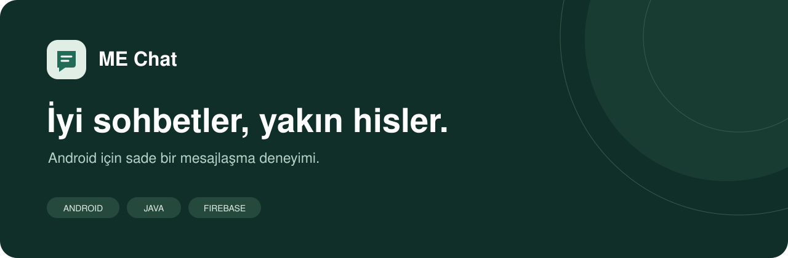
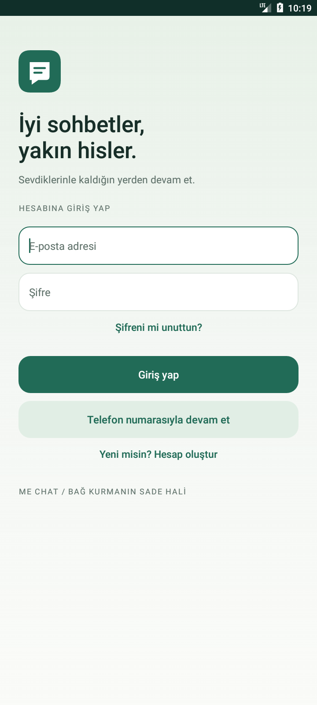
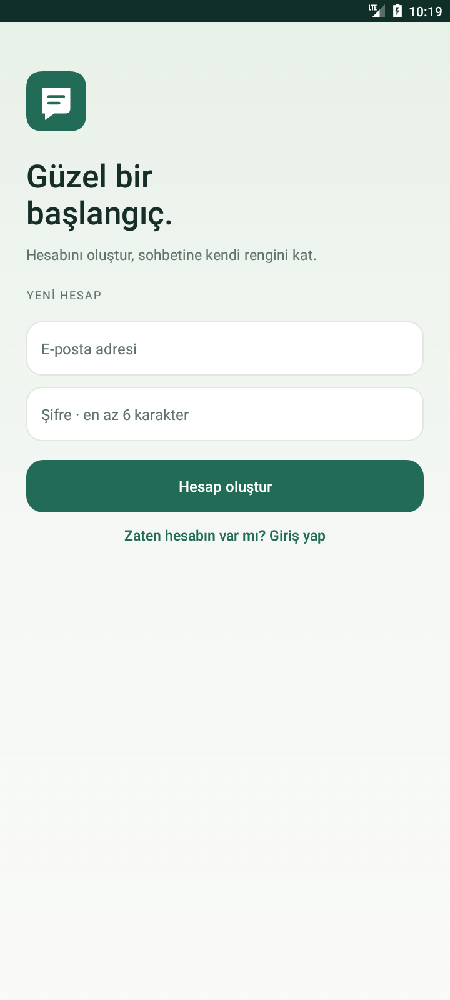
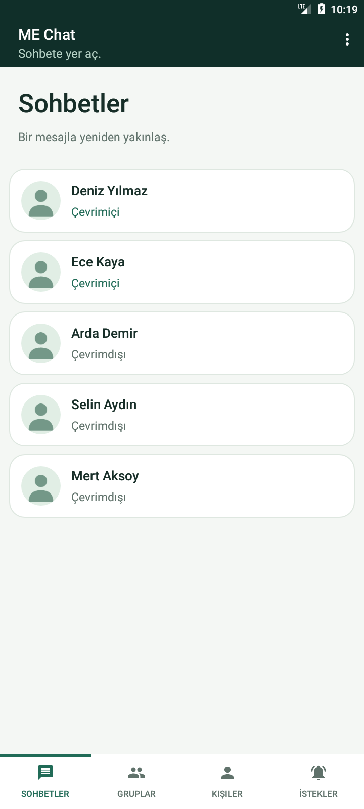
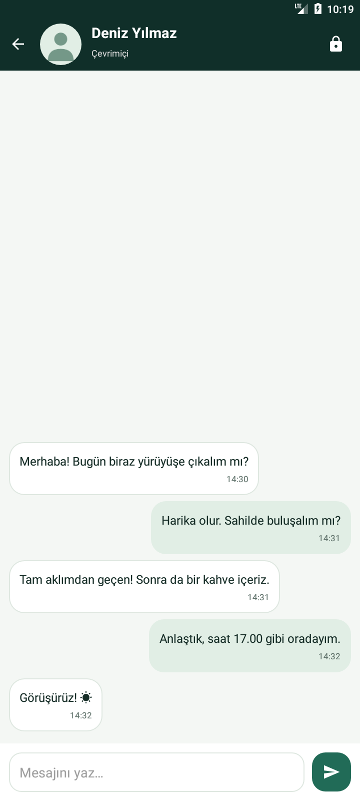
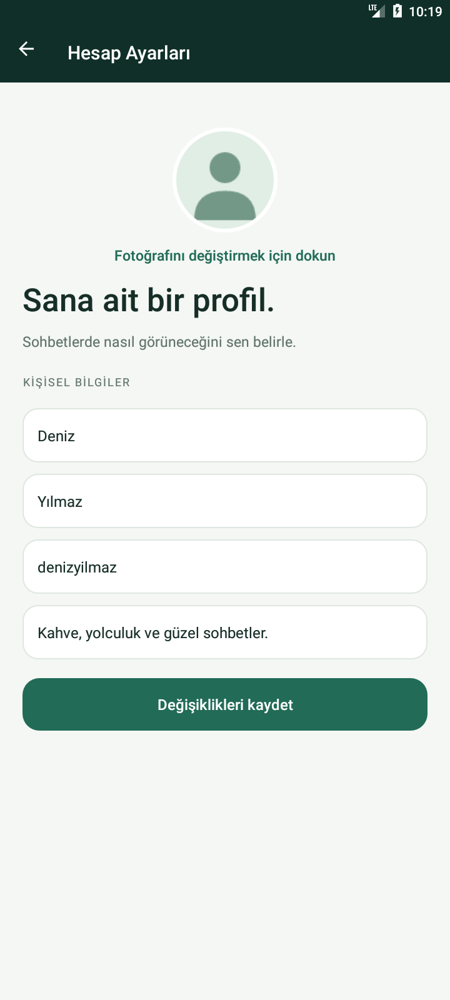
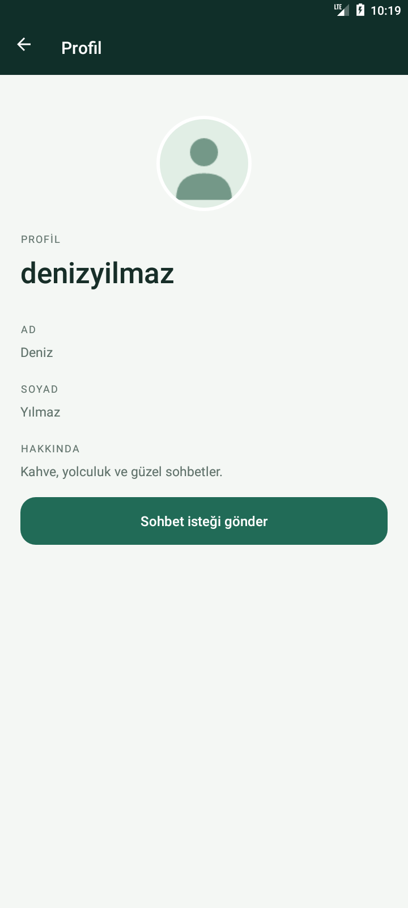

# ME Chat · Ürün tanıtımı



**İyi sohbetler, yakın hisler.**

ME Chat, insanlarla bağlantı kurmayı sade bir Android deneyiminde bir araya getirir. Bir arkadaşını bul, sohbet isteği gönder, birebir konuşmaya başla veya herkese açık bir grupta sohbete katıl.

[Proje ana sayfası](../../README.md) · [Kurulum](../../README.md#kurulum) · [Görselleri yeniden üretme](SCREENSHOTS.md)

## Ekran galerisi

### İlk karşılaşma

Giriş ve kayıt ekranları, açık yönlendirmeler ve ortak form tasarımıyla hesabına ulaşmanı kolaylaştırır. E-posta ile girişin yanında telefon numarasıyla doğrulama seçeneği de bulunur.

<table>
  <tr>
    <td align="center" width="50%"><strong>Giriş</strong><br /><br /></td>
    <td align="center" width="50%"><strong>Kayıt</strong><br /><br /></td>
  </tr>
</table>

### Sohbetin merkezinde

Sohbetler, gruplar, kişiler ve istekler alt sekmelerden erişilebilir. Birebir konuşmalarda gelen ve giden mesajlar farklı zeminlerle ayrılır; mesaj yazma alanı ekranın altında yer alır.

<table>
  <tr>
    <td align="center" width="50%"><strong>Sohbet listesi</strong><br /><br /></td>
    <td align="center" width="50%"><strong>Birebir mesajlaşma</strong><br /><br /></td>
  </tr>
</table>

### Sana ait bir alan

Profil fotoğrafını, adını, kullanıcı adını ve hakkında metnini düzenleyebilirsin. Bir kişinin profilinden sohbet isteği göndererek iletişimi başlatabilirsin.

<table>
  <tr>
    <td align="center" width="50%"><strong>Hesap ayarları</strong><br /><br /></td>
    <td align="center" width="50%"><strong>Kullanıcı profili</strong><br /><br /></td>
  </tr>
</table>

**Görsel notu:** Ekranlar gerçek uygulama yerleşimleri ve adaptörleri kullanılarak Android emülatöründe çekilmiştir. Galerideki tüm kişi adları, durumlar, profil metinleri ve mesajlar kurgusal tanıtım verileridir. Görsel üretimi Firebase'e veri yazmaz; çalışan bir sunucu akışının kanıtı olarak sunulmaz.

## Tasarım dili

| Öğe | Tercih | Amaç |
| --- | --- | --- |
| Ana vurgu | `#216B57` · Yeşil | Birincil işlemleri belirginleştirmek |
| Başlık alanı | `#102F29` · Koyu yeşil | Ekran hiyerarşisini güçlendirmek |
| Arka plan | `#F4F7F4` · Açık zemin | İçeriğe sakin bir alan bırakmak |
| İkincil yüzey | `#E1EEE5` · Açık yeşil | Mesajları ve ikincil işlemleri ayırmak |
| Metin | `#172E28` · Koyu mürekkep | Okunabilirliği korumak |
| Hareket | 220 ms ekran geçişleri | Gezinmede görsel süreklilik sağlamak |

Yuvarlatılmış yüzeyler, ortak tipografi, yeterli dokunma alanları ve kaydırılabilir formlar tasarımın temelini oluşturur. Mevcut arayüz açık tema kullanır.

## Temel akışlar

1. **Hesabını oluştur:** E-posta/şifre ile kayıt ol veya telefon numaranı doğrula.
2. **Profilini tamamla:** Adını, kullanıcı adını ve hakkında bilgini kaydet.
3. **Birini bul:** Kullanıcı adına göre arama yap ve sohbet isteği gönder.
4. **Sohbete başla:** İstek kabul edildiğinde birebir mesajlaşmaya geç.
5. **Birlikte konuş:** Herkese açık bir grup oluştur veya mevcut bir gruba katıl.

Özel mesajlarda uçtan uca şifreleme ve güvenlik numarası kontrolü bulunur. Grup mesajları uçtan uca şifreleme kapsamında değildir. Teknik ayrıntılar ve kurulum için [ana README](../../README.md) kullanılabilir.

## Klasör içeriği

```text
docs/tanitim/
├── README.md              # Ürün tanıtımı ve tam ekran galerisi
├── SCREENSHOTS.md         # Görsellerin kaynağı ve yeniden üretim adımları
└── assets/
    ├── cover.svg          # GitHub uyumlu vektör kapak
    └── screenshots/       # Altı özgün PNG ekran görüntüsü
```

Görseller depoda tutulur ve Markdown dosyaları göreli bağlantılar kullanır. Harici görsel barındırma servisine ihtiyaç duyulmaz.
